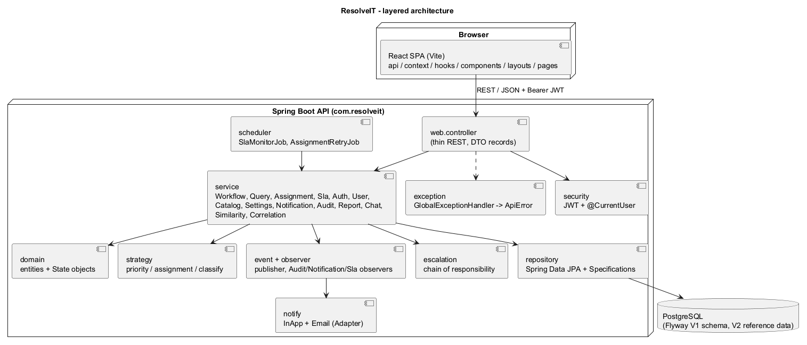

# 1. Problem Analysis

## 1.1 The problem

Every modern organisation depends on IT services: payment and billing applications, login and identity systems, databases, networks, e-mail, cloud storage and enterprise software such as ERP. When one of these services fails, employees cannot do their work and, in many cases, customers are affected as well.

In many organisations problems are still reported informally — a message on a chat group, a phone call to a known person in the IT team, or an e-mail to a shared inbox. This works for a handful of problems a week, but it breaks down as soon as the organisation grows. Our project, **ResolveIT**, is an Intelligent IT Service Management and Incident Resolution System that replaces this informal process with a single, structured platform.

The guiding scenario from the assignment is used throughout this report:

> An employee reports: *"The organisation's payment application is unavailable and users are unable to complete transactions."*

ResolveIT must turn this sentence into a tracked incident, decide how serious it is, choose the right technician, watch the deadline, keep everyone informed and keep a full history until the incident is closed.

## 1.2 Stakeholders

| Stakeholder | Interest in the system |
|---|---|
| **Employee (reporter)** | Report a problem quickly, know who is working on it, see progress, talk to the technician and confirm when it is really fixed. |
| **Technician (support engineer)** | Receive a fair, organised queue of work that matches their skills, see deadlines clearly, record investigation notes and resolutions. |
| **Team lead** | Be alerted when critical incidents are not picked up in time. |
| **Administrator (IT service desk manager)** | Manage people, services and policies; monitor all incidents, SLA compliance and workload; review reports and the audit log. |
| **IT manager** | The last escalation level for critical incidents; interested in overall service health. |
| **Organisation / business owners** | Fewer and shorter outages of business-critical services, measurable service quality. |

## 1.3 Existing challenges

Managing incidents manually leads to the problems listed in the assignment, which we observed in our own discussion of how campus IT support works:

- **Delayed response** — nobody is clearly responsible for a new report, so it waits until someone notices it.
- **Incorrect prioritisation** — a printer jam and a payment outage arrive in the same inbox and are handled in arrival order.
- **Inefficient technician allocation** — work goes to whoever is known or available, not to whoever has the right skills and free capacity.
- **SLA violations** — there is no clock running, so missed response and resolution targets are discovered late or never.
- **Poor visibility** — managers cannot see how many incidents are open, which services fail most often or which technicians are overloaded.
- **Duplicate reports** — ten people report the same outage separately and ten people work on it.
- **Incomplete history** — decisions and actions are spread across chats and e-mails, so there is no reliable timeline.
- **Recurring problems go unnoticed** — the same fix is rediscovered again and again.

## 1.4 Proposed solution

ResolveIT is a full-stack web application with three role-based portals (Employee, Technician, Administrator). Its core idea is that **every incident follows a defined lifecycle** and that the system does as much of the routine work as possible automatically:

1. The employee describes the problem in plain words.
2. The system **creates** the incident and **classifies** it into a category using weighted keywords.
3. It **identifies the affected IT service** and its business criticality.
4. It derives **impact, urgency and the number of affected users** from the description.
5. It **calculates the priority** (P1–P4) with a configurable algorithm.
6. It applies the **SLA policy** for that priority and computes response and resolution deadlines.
7. It **selects a suitable technician** using a configurable assignment strategy.
8. It **notifies** the people involved (in-app and by simulated e-mail).
9. The technician accepts, investigates, chats with the employee and resolves.
10. A background monitor **tracks SLA compliance**, sends warnings and records violations; unacknowledged critical incidents are **escalated** automatically.
11. **Every action is written to an audit log.**
12. The incident is **closed only when both the technician and the employee approve**.
13. Closed incidents feed the **reports and analytics** and are used to **suggest resolutions** for similar future problems.

## 1.5 Assumptions

- The system serves a single organisation with one IT support group (no multi-tenant support).
- E-mail delivery is **simulated**: every notification is written to an e-mail outbox table. Real SMTP can be plugged in later through an adapter.
- SLA clocks run on wall-clock time from the moment an incident is created; business hours and holidays are not modelled.
- Employee accounts are created by the administrator; there is no public sign-up page.
- Team leads are technicians with a team-lead flag; they receive escalations rather than ordinary assignments. The IT manager is an administrator with a higher level.
- Classification is rule-based (weighted keywords stored in the database). This is explicitly allowed by the assignment ("a well-designed rule-based system is perfectly acceptable").
- The application is run locally for the course (backend, frontend and PostgreSQL on one machine); cloud deployment is out of scope.
- Demo data (30 users and 36 incidents in November 2026) is generated automatically for the demonstration and can be disabled.

# 2. Requirements Specification

## 2.1 User roles

| Role | Description | Main abilities |
|---|---|---|
| Employee | Any member of staff who uses IT services | Sign in, report an incident, view and track own incidents, add information, chat with the technician, approve or reject closure, give feedback |
| Technician | Support engineer with one or more skill categories | View assignment requests, accept or decline, start work, add investigation notes, request information, resolve, approve closure, view workload and suggested resolutions |
| Team lead | Senior technician | Everything a technician can do; receives level-2 escalations |
| Administrator | IT service desk manager | Manage employees and technicians, IT services, categories and keywords, SLA policy and strategies; monitor, edit, reassign and advance incidents; view reports, audit log and SLA violations |
| IT manager | Top of the escalation chain | Administrator access; receives level-4 escalations |
| Scheduler (system actor) | Background jobs inside the backend | Monitor SLA deadlines, escalate, retry unassigned incidents |

## 2.2 Functional requirements

**Authentication and users**

| ID | Requirement |
|---|---|
| FR1 | Users sign in with their ID or e-mail, password and the portal they choose. A wrong password, unknown user or wrong portal all give the same generic error. |
| FR2 | Five failed sign-ins lock the account for 15 minutes. |
| FR3 | Administrators create, edit, deactivate and reactivate employee and technician accounts. Deactivation keeps all history; a deactivated technician's open incidents are reassigned. |

**Incident management**

| ID | Requirement |
|---|---|
| FR4 | An employee creates an incident with a title, description, optional affected service and optional number of affected users. |
| FR5 | The system classifies the incident, identifies the service, derives impact, urgency and affected users, and calculates the priority automatically. |
| FR6 | The system computes response and resolution deadlines from the SLA policy of the priority. |
| FR7 | The system offers the incident to one eligible technician chosen by the active assignment strategy. |
| FR8 | A technician can accept or decline an offer. A declined incident is immediately offered to another eligible technician. |
| FR9 | A technician can start work, add notes, request information from the employee and resolve the incident with a resolution summary, root cause and steps. |
| FR10 | The employee and the technician both approve before an incident is closed. If either rejects, work resumes. |
| FR11 | Employees can add information and chat with the assigned technician inside the incident. |
| FR12 | After resolution the employee can rate the support (1–5) and leave a comment, once per incident. |
| FR13 | Administrators can edit category, impact, urgency and affected users; priority and SLA are recalculated together. |
| FR14 | Administrators can reassign or remove the technician, and move an incident forward by at most two steps (never directly to Verified or Closed). |

**Monitoring, notification and history**

| ID | Requirement |
|---|---|
| FR15 | A background monitor checks open incidents every 30 seconds, warns when 80 % of a target has elapsed and records a violation when a deadline passes. Each warning and violation happens exactly once. |
| FR16 | P1 and P2 incidents that are not acknowledged by their response deadline are escalated: technician → team lead → administrator → IT manager. |
| FR17 | Important events create notifications for the right people through every notification channel (in-app and e-mail). |
| FR18 | Every important action is written to an append-only audit log with timestamp, user, action, incident, previous state, new state and description. |
| FR19 | Users can remove individual notifications or clear all of them. |

**Search, reporting and intelligence**

| ID | Requirement |
|---|---|
| FR20 | Incidents can be searched by incident ID or text, status, priority, category, service, technician, SLA status and date range. Results are limited to what the user may see. |
| FR21 | Administrators see monthly reports: incident overview, incidents per service, active incidents per technician, priority and category breakdown, average response and resolution time, SLA compliance, average rating and a daily trend. |
| FR22 | Near-identical open incidents from the same employee are blocked as duplicates (the employee may submit anyway). Similar incidents from different employees on the same service within one hour are linked as related; three or more trigger a "possible major incident" alert. |
| FR23 | Technicians see up to three suggested resolutions from similar closed incidents. |
| FR24 | Administrators see a ranked list of recommended technicians with the score components visible. |
| FR25 | Administrators can add categories and keywords at run time; the next incident is classified with them. |

## 2.3 Non-functional requirements

| Category | Requirement |
|---|---|
| Maintainability | Layered architecture; each class has one responsibility; business rules live in domain and service classes, never in controllers or the user interface. |
| Extensibility | New priority algorithms, assignment strategies, notification channels, escalation levels and categories can be added without changing existing callers. |
| Reliability | A failing notification or observer never fails the main action. A failing incident never stops the SLA monitor. Every error returns a structured, readable message. |
| Security | Passwords hashed with BCrypt; signed tokens; role and ownership checks on every request; input validation; no stack traces in responses. |
| Persistence | All data is stored in PostgreSQL; the schema is versioned and reproducible. |
| Usability | Different, consistent portals per role; every page has loading, empty and error states; readable font sizes; works on laptop and tablet widths. |
| Performance | Typical requests complete well under one second on a laptop with the demo data. Lists refresh every 5 seconds. |
| Testability | Automated unit and integration tests run with one command and need no external database. |

## 2.4 Business rules

**Rule 1 — Priority calculation.** Every incident has four values on a 1–4 scale:

- **Impact**: how badly the service is affected (4 = completely unavailable, 1 = a single user with a workaround).
- **Urgency**: how soon the business needs it fixed (4 = business-stopping, 1 = can wait several days).
- **Business criticality**: taken from the affected IT service (Payment, Authentication and Database are 4; General IT is 1).
- **Affected users**: 1 = just me, 2 = a few people, 3 = a team or department, 4 = everyone or customers.

The default **multiplicative** strategy computes:

`Score = max(Impact, Affected users) × Urgency × Business criticality` (range 1–64)

| Score | Priority |
|---|---|
| 36 – 64 | P1 – Critical |
| 18 – 35 | P2 – High |
| 8 – 17 | P3 – Medium |
| 1 – 7 | P4 – Low |

*Rationale:* the multiplication keeps each business factor visible and makes a problem critical only when it is serious on several dimensions at once. Using the larger of impact and affected users reflects that the "blast radius" of an incident is defined both by how broken the service is and by how many people are affected.

The alternative **weighted** strategy, which the administrator can switch to at any time, computes

`Score = (0.35 × Impact + 0.25 × Urgency + 0.25 × Criticality + 0.15 × Affected users) / 4 × 100`

with P1 ≥ 85, P2 ≥ 65, P3 ≥ 40 and P4 below 40. It gives a smoother score and is less sensitive to a single low factor.

*Worked examples (multiplicative):*

| Incident | Impact | Urgency | Criticality | Affected | Score | Priority |
|---|---|---|---|---|---|---|
| Payment application unavailable, transactions failing | 4 | 4 | 4 | 3 | 64 | P1 |
| Login failing for a whole department | 3 | 3 | 4 | 3 | 36 | P1 |
| Shared drive full, team cannot save files today | 3 | 3 | 3 | 3 | 27 | P2 |
| Wi-Fi slow for some users | 2 | 2 | 3 | 2 | 12 | P3 |
| Single printer paper jam | 1 | 2 | 2 | 1 | 4 | P4 |

**Rule 2 — SLA targets.** Default targets (editable by the administrator):

| Priority | Response target | Resolution target |
|---|---|---|
| P1 | 5 minutes | 30 minutes |
| P2 | 15 minutes | 2 hours |
| P3 | 1 hour | 8 hours |
| P4 | 4 hours | 24 hours |

*Response* means the technician accepted the incident; *resolution* means the incident reached Resolved. Deadlines are measured from the creation time and recalculated whenever the priority changes. A warning is sent when 80 % (configurable) of a target has elapsed. If a policy is missing, the built-in defaults above are used and administrators are notified.

**Rule 3 — Lifecycle.** NEW → CLASSIFIED → ASSIGNED → ACKNOWLEDGED → IN_PROGRESS → RESOLVED → VERIFIED → CLOSED.

| From | Allowed next states |
|---|---|
| NEW | CLASSIFIED |
| CLASSIFIED | ASSIGNED |
| ASSIGNED | ACKNOWLEDGED (accepted), CLASSIFIED (declined) |
| ACKNOWLEDGED | IN_PROGRESS, CLASSIFIED (technician removed) |
| IN_PROGRESS | RESOLVED, CLASSIFIED (technician removed) |
| RESOLVED | VERIFIED (both approved), IN_PROGRESS (closure rejected) |
| VERIFIED | CLOSED (automatic) |
| CLOSED | none — terminal |

Any other move (for example NEW → CLOSED or ASSIGNED → RESOLVED) is rejected with a clear message.

**Rule 4 — Technician eligibility and assignment.** A technician is eligible for an incident only if they are active, linked to the incident's IT service, below their maximum workload and have not already declined that incident. Workload counts incidents in Assigned, Acknowledged, In progress and Resolved, so a pending offer already counts. Among eligible technicians the active strategy chooses: **least workload** (default), **round robin**, or **best skill match and experience**. If nobody is eligible, the incident stays unassigned, administrators are alerted, and a retry job tries again every minute with P1 incidents first.

**Rule 5 — Escalation.** If a P1 or P2 incident is still not acknowledged after its response deadline, it moves one level up the chain for every further response window that passes: level 1 reminds the technician, level 2 alerts the team lead, level 3 the administrators and level 4 the IT manager. Each level happens once.

**Rule 6 — Duplicates and related incidents.** Similarity is measured as the overlap of meaningful words (Jaccard similarity after removing common words). An open incident from the same employee with similarity ≥ 0.85 is a duplicate; incidents from different employees on the same service within 60 minutes with similarity ≥ 0.5 are related; three related incidents raise a major-incident alert.

**Rule 7 — Closure and feedback.** Only the reporter and the assigned technician can approve closure. Feedback can be given once, by the reporter, after the incident is resolved.

# 3. System Architecture

## 3.1 Overview

ResolveIT follows a **layered client–server architecture**. The React single-page application in the browser talks to a Spring Boot REST API over JSON. Inside the backend, requests pass through thin controllers into application services, which use the domain model, strategies and repositories. PostgreSQL stores all data.



## 3.2 Components and their responsibilities

| Layer / component | Responsibility | Main classes |
|---|---|---|
| Frontend (React) | Role-specific portals, forms, lists, charts, chat and notification panel. Polls for updates every 5 seconds. | `Workspace`, `IncidentList`, `IncidentRow`, `NotificationPanel`, `Analytics` |
| Controllers | Receive HTTP requests, validate input DTOs, resolve the signed-in user, call one service method, return a DTO. No business logic. | `IncidentController`, `TechnicianController`, `AdminIncidentController`, `AdminDirectoryController`, `ReportController`, `NotificationController`, `AuthController` |
| Security | Verify the bearer token and load the current user. | `JwtTokenService`, `CurrentUserArgumentResolver` |
| Application services | Implement use cases and business rules; manage transactions. | `IncidentWorkflowService`, `IncidentQueryService`, `AssignmentService`, `SlaService`, `NotificationService`, `AuditService`, `ReportService`, `ChatService`, `CatalogService`, `UserService`, `AuthService`, `SettingsService` |
| Domain model | Entities with behaviour; the incident lifecycle rules (State objects). | `Incident`, `PortalUser` and subclasses, `IncidentState` implementations |
| Strategies | Interchangeable algorithms chosen at run time from the settings table. | `PriorityStrategy`, `AssignmentStrategy`, `CategoryClassifier` |
| Events and observers | Decouple audit and notifications from the workflow. | `IncidentEventPublisher`, `AuditObserver`, `NotificationObserver`, `SlaObserver` |
| Escalation | Chain of handlers for automatic escalation. | `EscalationService`, `EscalationHandler` subclasses |
| Notification channels | Deliver each notification in-app and by (simulated) e-mail. | `InAppChannel`, `EmailChannel`, `MailGateway` |
| Scheduler | Background jobs. | `SlaMonitorJob`, `AssignmentRetryJob` |
| Repositories | All database access (Spring Data JPA) and dynamic search. | `IncidentRepository`, `IncidentSpecifications`, … |
| Database | PostgreSQL schema created by Flyway migrations. | `V1__schema.sql`, `V2__seed_reference.sql` |
| Error handling | Converts every failure into one uniform error response. | `GlobalExceptionHandler`, `ItsmException` hierarchy |

## 3.3 Example interaction — reporting the payment outage

1. The employee submits the form; the frontend sends `POST /api/incidents` with the title and description and the bearer token.
2. `IncidentController` validates the request and calls `IncidentWorkflowService.createIncident`.
3. The workflow service checks for a duplicate, asks `IncidentFactory` to create the incident (INC1036, status NEW) and saves it.
4. `KeywordCategoryClassifier` returns *Application*; `CatalogService` identifies the *Payment* service (criticality 4); the analysers return impact 4, urgency 4 and affected users 3.
5. The active `PriorityStrategy` returns score 64 → P1; `SlaService` sets the response deadline (+5 min) and resolution deadline (+30 min).
6. `IncidentCorrelationService` looks for related reports from other employees.
7. `AssignmentService` filters eligible technicians and asks the active `AssignmentStrategy` to pick one; the incident becomes ASSIGNED.
8. After each step an `IncidentEvent` is published. `AuditObserver` writes the audit row; `NotificationObserver` creates notifications ("Incident received" for the employee, "New incident assigned" for the technician, "Incident needs attention" for administrators) and sends them through both channels.
9. The controller returns the incident as JSON and the employee sees it under *Ongoing incidents*.

## 3.4 Project structure

```
backend/src/main/java/com/resolveit/
  config/        clock, strategy registries, security, CORS, scheduling
  security/      JWT token service, current-user resolver
  domain/        user, incident (+ state), catalog, sla, notification, audit, settings
  strategy/      priority, assignment, classify, StrategyRegistry
  event/         IncidentEvent, IncidentEventPublisher, IncidentObserver
  observer/      AuditObserver, NotificationObserver, SlaObserver
  notify/        NotificationChannel, InAppChannel, EmailChannel, MailGateway
  escalation/    EscalationHandler chain, EscalationService
  factory/       IncidentFactory, NotificationFactory, UserFactory, IncidentStateFactory
  service/       application services
  repository/    Spring Data repositories, IncidentSpecifications
  web/           controller, dto, mapper
  exception/     ItsmException hierarchy, GlobalExceptionHandler
  scheduler/     SlaMonitorJob, AssignmentRetryJob
  seed/          demo data seeders
backend/src/main/resources/db/migration/   Flyway SQL migrations
frontend/src/    api, context, hooks, utils, components, layouts, pages
docs/            report, UML and ER diagrams, test cases, API contract
```
