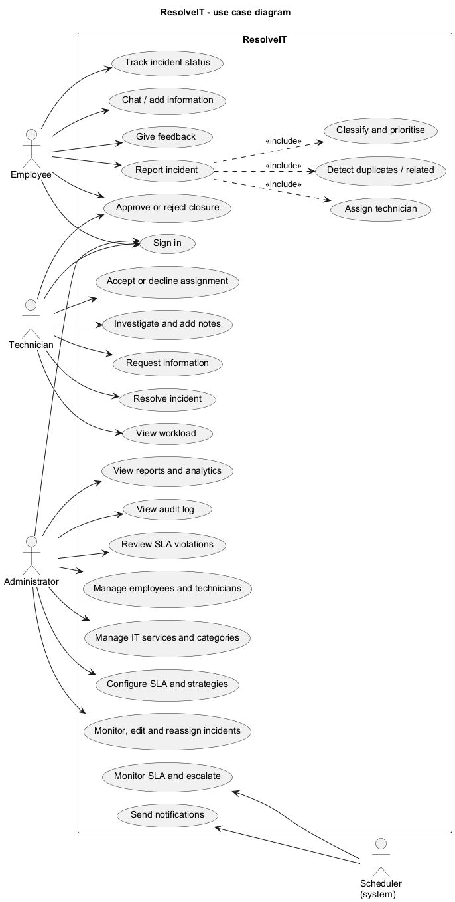
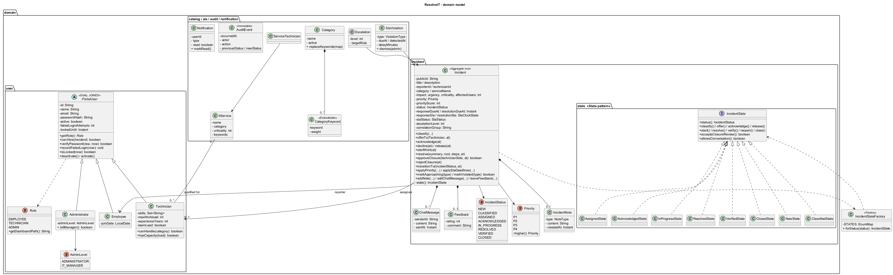
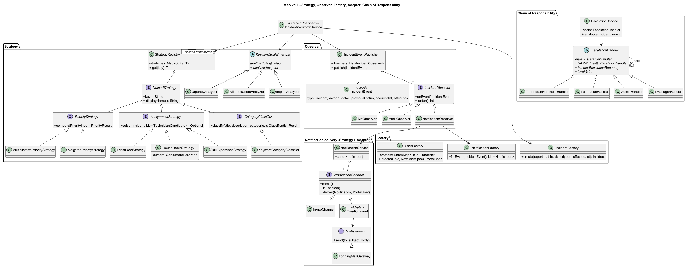
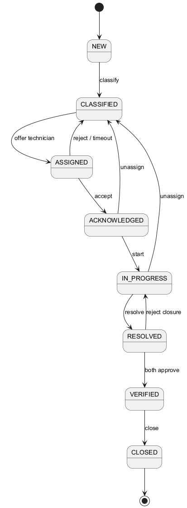

# 4. UML Diagrams

## 4.1 Use case diagram

The use case diagram shows the three human actors and the system actor (the background scheduler) and the main functions each one uses. Reporting an incident always *includes* classification and prioritisation, duplicate detection and technician assignment, which run automatically.



| Actor | Key use cases |
|---|---|
| Employee | Sign in, report incident, track status, chat and add information, approve or reject closure, give feedback |
| Technician | Accept or decline assignment, investigate and add notes, request information, resolve, approve closure, view workload |
| Administrator | Manage employees, technicians, services and categories; configure SLA and strategies; monitor, edit and reassign incidents; view reports, audit log and SLA violations |
| Scheduler | Monitor SLA deadlines and escalate; retry unassigned incidents; send notifications |

## 4.2 Class diagram — domain model

The domain class diagram shows the main classes with their attributes and methods, the user inheritance hierarchy, the composition between an incident and its notes, chat messages and feedback, the eight State classes, and the associations to employees, technicians and services.



Key relationships shown:

- **Inheritance:** `Employee`, `Technician` and `Administrator` extend the abstract class `PortalUser`.
- **Interface realisation:** the eight state classes implement `IncidentState`.
- **Composition:** an `Incident` owns its `IncidentNote`s, `ChatMessage`s and its `Feedback`; they cannot exist without it.
- **Aggregation:** a `Category` holds its keywords; a technician holds a set of skills.
- **Association:** an incident refers to one reporter (`Employee`) and at most one assignee (`Technician`); technicians are linked to the IT services they are qualified for.

## 4.3 Class diagram — design patterns

The second class diagram focuses on the behavioural and creational patterns: the strategy families, the observer mechanism, the notification channels with the e-mail adapter, the factories and the escalation chain.



## 4.4 State diagram — incident lifecycle



# 5. Object-Oriented Design

The assignment treats the quality of object-oriented design as a major criterion. This section explains where each concept appears in our code, with short excerpts from the real source.

## 5.1 Encapsulation

All entity fields are `private`. The `Incident` class has **no public setter for its status**; status can only change through behaviour methods such as `acknowledge()`, `resolve()` or `approveClosure()`, which first ask the current state whether the move is allowed. A unit test checks by reflection that no public `set…` method exists. `PortalUser` hides the BCrypt password hash and the lockout counters and only exposes `verifyPassword`, `recordFailedLogin` and `isLocked`. Collections are returned as read-only views.

```java
public void acknowledge(Instant at) {
    IncidentStatus next = state().acknowledge();   // throws if not allowed
    moveTo(next, at);
    meetClock(ViolationType.RESPONSE, at, responseDueAt);
}
```

## 5.2 Abstraction

`IncidentWorkflowService.createIncident()` hides a ten-step pipeline behind one method call: validate, check duplicates, create, classify, identify the service, assess impact and urgency, calculate priority, apply the SLA, correlate and assign. Callers (the controller and the demo seeder) do not know about any of these steps. In the same way `SlaService` hides policy lookup and fallback, and `AssignmentService` hides eligibility filtering and strategy selection.

## 5.3 Inheritance

Inheritance is used only for real "is-a" relationships:

- `Employee`, `Technician` and `Administrator` **are** portal users. They share identity, password and lockout behaviour in `PortalUser` and add their own data (join date; skills, workload and experience; admin level). In the database this is mapped with the JPA *JOINED* strategy: one shared `users` table plus one table per subclass.
- `ImpactAnalyzer`, `UrgencyAnalyzer` and `AffectedUsersAnalyzer` **are** keyword scale analysers. The base class implements the matching algorithm; each subclass only defines its rules (a template method).
- The four escalation handlers **are** escalation handlers.
- Every domain exception **is an** `ItsmException`.

## 5.4 Polymorphism

Many decisions are made by calling a method on an interface or abstract class and letting the concrete object decide:

- `PortalUser.canView(Incident)` is overridden by each role: an employee may see incidents they reported, a technician those assigned to them and an administrator all. Ownership checks therefore contain no role `if` statements.
- The current `IncidentState` decides which lifecycle moves are legal.
- The selected `PriorityStrategy`, `AssignmentStrategy` and `CategoryClassifier` are called through their interfaces.
- `NotificationService` loops over all `NotificationChannel`s without knowing their concrete types.

```java
public abstract boolean canView(Incident incident);              // PortalUser
@Override public boolean canView(Incident i) {                   // Employee
    return getId().equals(i.getReporterId());
}
@Override public boolean canView(Incident i) { return true; }    // Administrator
```

## 5.5 Interfaces

Interfaces define the contracts between parts of the system: `IncidentState`, `PriorityStrategy`, `AssignmentStrategy`, `CategoryClassifier`, `NamedStrategy`, `NotificationChannel`, `MailGateway` and `IncidentObserver`. All repositories are interfaces implemented automatically by Spring Data.

## 5.6 Composition, association and aggregation

`Incident` is an aggregate root: its notes, chat messages and feedback are created only through the incident (`addNote`, `addChatMessage`, `leaveFeedback`) and are deleted with it. Services are composed of their collaborators, which are injected through the constructor; for example `IncidentWorkflowService` is composed of the classifier and priority registries, three analysers, the catalog, SLA, assignment and correlation services, the event publisher and the clock. Associations connect incidents to their reporter and technician, and technicians to services; a technician aggregates a set of skill categories.

## 5.7 Exception handling

We created a custom exception hierarchy. Each exception carries an error code, an HTTP status and a message that is safe to show to users. One global handler converts any exception into the same JSON shape, and unexpected errors return a generic message with a correlation id instead of a stack trace.

| Situation from the assignment | Exception | HTTP status |
|---|---|---|
| Invalid login | `InvalidCredentialsException` | 401 |
| Unauthorised operation | `UnauthorizedOperationException` | 403 |
| Invalid incident | `ResourceNotFoundException` | 404 |
| Invalid state transition | `InvalidStateTransitionException` | 409 |
| Technician unavailable | `TechnicianUnavailableException` | 409 |
| Workload exceeded | `WorkloadExceededException` | 409 |
| Service not found | `ServiceNotFoundException` | 404 |
| Missing SLA configuration | `MissingSlaConfigurationException` (caught, defaults used) | — |
| Duplicate incident | `DuplicateIncidentException` (includes the existing id) | 409 |
| Database failure | handled in `GlobalExceptionHandler` | 503 |
| Network failure (mail) | `ExternalServiceException` | 502 |
| Invalid user input | `ValidationException` (with field errors) | 400 |
| Account locked | `AccountLockedException` | 423 |

## 5.8 Collections and data structures

| Data structure | Where | Why |
|---|---|---|
| `EnumMap` | State objects per status, allowed actions per role, SLA defaults per priority, user creators per role | Fast, type-safe lookup keyed by an enum |
| `PriorityQueue` | Retrying unassigned incidents | Always processes P1 first, then the oldest |
| `ConcurrentHashMap<String, AtomicInteger>` | Round-robin cursor per service | Thread-safe counters |
| `TreeSet` / `Set` | Technician skills, technicians who declined an incident | No duplicates; sorted skills |
| `List` | Notes and chat messages | Kept in time order |
| `LinkedHashMap` / `TreeMap` | Report data | Predictable ordering in charts |

## 5.9 Design patterns

We implemented eight patterns; every pattern class carries a comment naming its pattern.

**State — incident lifecycle.** Each status has its own class. The interface makes every action illegal by default, and a state overrides only the moves that are legal from it. `Incident` delegates to `IncidentStateFactory.forStatus(status)`.

```java
public interface IncidentState {
    IncidentStatus status();
    default IncidentStatus acknowledge() { throw illegal("accept"); }
    default IncidentStatus resolve()     { throw illegal("resolve"); }
    // ... classify, offer, release, start, verify, reopen, close
}
public final class AssignedState implements IncidentState {
    public IncidentStatus status()      { return IncidentStatus.ASSIGNED; }
    public IncidentStatus acknowledge() { return IncidentStatus.ACKNOWLEDGED; }
    public IncidentStatus release()     { return IncidentStatus.CLASSIFIED; }
}
```

**Strategy — priority, assignment and classification.** Each algorithm family has an interface and several implementations registered in a `StrategyRegistry`. The key stored in the settings table selects the active one on every call, so the administrator can switch strategies without restarting or changing code.

```java
AssignmentStrategy strategy = strategies.get(settings.assignmentStrategy());
Technician chosen = strategy.select(incident, eligibleCandidates)
        .map(TechnicianCandidate::technician)
        .orElseThrow(TechnicianUnavailableException::new);
```

**Observer — audit, notifications and SLA records.** After each step the services publish an `IncidentEvent`. The publisher calls each observer in its own `try/catch`, so a broken observer can never fail the main action.

**Factory — incidents, users, notifications and states.** `IncidentFactory` creates new incidents with the next `INC` number; `UserFactory` creates the correct `PortalUser` subclass from an `EnumMap` of creators (no switch statement); `NotificationFactory` holds the whole "who is notified about what" matrix; `IncidentStateFactory` maps each status to its state object.

**Adapter — e-mail delivery.** `EmailChannel` adapts a `Notification` to an e-mail through the `MailGateway` interface. While mail is disabled it writes a SIMULATED row to the e-mail outbox; a network failure is recorded as FAILED.

**Chain of Responsibility — escalation.** Four handlers are linked in order (technician → team lead → administrator → IT manager). A request travels along the chain and each handler acts only when the request has reached its level. Adding a new level means linking one more handler.

**Repository — persistence.** All database access goes through Spring Data repositories. The audit repository extends the bare `Repository` marker and declares only `save` and read methods, so no update or delete exists for audit records.

**Specification — search.** Each search filter is a small reusable `Specification` that can be combined with `and(...)`.

# 6. Technology Stack and Selection

## 6.1 Technology stack

| Layer | Technology | Version |
|---|---|---|
| Programming language (backend) | Java | 17 (tested on JDK 25) |
| Backend framework | Spring Boot (Web, Data JPA, Validation, Security, Scheduling) | 3.3.5 |
| Object-relational mapping | Hibernate ORM | 6.5 |
| Database | PostgreSQL | 18 (works with 15+) |
| Database migrations | Flyway | 10 |
| Authentication | JSON Web Tokens (HS256), BCrypt password hashing | — |
| Build tool | Maven (wrapper included) | 3.9 |
| Testing | JUnit 5, Spring Boot Test, MockMvc, H2 (tests only) | — |
| Frontend language | JavaScript (JSX) | ES2022 |
| Frontend framework | React | 18.3 |
| Routing | React Router | 6.28 |
| Build tool / dev server | Vite | 5.4 |
| Data fetching | Axios, TanStack Query | 1.7, 5.59 |
| Charts | Recharts | 2.13 |
| Icons and messages | lucide-react, react-hot-toast | — |
| Diagrams | PlantUML | 1.2024 |
| Version control | Git and GitHub | — |
| Optional | Docker Compose (PostgreSQL container) | — |

## 6.2 Technology selection report

**1. Why Java?** Java is a strongly typed, fully object-oriented language with classes, abstract classes, interfaces, enums, records, generics and a mature exception system. Every OOP concept required by the course can be expressed directly, and the compiler catches many mistakes early. It is also the language of the course.

**2. Why React for the frontend?** React's component model fits our three role-based portals well: shared components such as the incident row, chat panel, search bar and notification panel are written once and reused by every role. Vite gives a fast development loop and a small production build, and Recharts provides the required pie and bar charts.

**3. Why Spring Boot for the backend?** Spring Boot provides REST controllers, validation, security, scheduling and database access with very little setup. Its dependency injection makes our design patterns natural: all `AssignmentStrategy` beans are collected into a registry, all observers into the publisher, all channels into the notification service, and services receive their collaborators through constructors.

**4. Why PostgreSQL?** Our data is clearly relational (users, incidents, notes, violations, escalations, audit rows) and needs integrity: foreign keys, unique and check constraints, indexes and reliable time stamps. PostgreSQL is free, widely used in industry and has excellent support in Spring and Flyway. Flyway makes the schema reproducible on any machine, and Hibernate validates at start-up that the Java classes match the tables.

**5. Why a layered architecture?** Separating presentation, API, services, domain and persistence keeps each class focused and makes the system easy to test and explain. The event publisher between services and audit/notification code keeps those concerns loosely coupled.

**6. Alternatives considered.** *Node.js + Express + MongoDB*: quick to start, but weaker typing, fewer built-in OOP constructs, and a document store fits our relational data poorly. *Django + PostgreSQL*: very productive, but Python's OOP is less strict and less aligned with the course. *ASP.NET Core + SQL Server*: technically comparable to Spring Boot, but less familiar to the team and with fewer course resources. *A mobile app*: unnecessary for an internal service desk used mainly at desks.

**7. Advantages and limitations.** Advantages: strong typing, clear structure, easy testing (172 automated tests), a versioned database schema and strategies that can be switched at run time. Limitations: the application runs on a single server; updates use polling every 5 seconds instead of push; SLA clocks ignore business hours; e-mail is simulated; logged-out tokens are remembered only in memory.

**8. How the technology supports object-oriented design.** JPA inheritance maps our user class hierarchy directly to tables. Interfaces combined with dependency injection give run-time polymorphism for strategies, observers and channels. Enums with behaviour (`IncidentStatus`, `Priority`) and Java records (DTOs and events) keep data and rules together. Spring Data turns repository interfaces into implementations, which is the Repository pattern provided by the framework.

**9. How the system would evolve with many more users.** The API is stateless (token-based), so several backend instances can run behind a load balancer. Reports could be served from a PostgreSQL read replica, catalog and settings could be cached, notifications could move to a message queue, and the scheduled jobs would need leader election so that only one instance runs them. Polling could be replaced by WebSockets. Only if the load grew very large would we split the system into separate services (incident, SLA, notification).
