# 7. Source Code

The complete source code is in our GitHub repository:

**https://github.com/jinayshah3210/Incident-Resolution-System**

| Part | Location | Size |
|---|---|---|
| Backend (Java, Spring Boot) | `backend/src/main/java/com/resolveit` | about 150 classes in 16 packages |
| Database migrations | `backend/src/main/resources/db/migration` | 2 SQL files |
| Automated tests | `backend/src/test/java/com/resolveit` | 10 test classes, 172 tests |
| Frontend (React) | `frontend/src` | 25 components and pages |
| Documentation | `docs/` | report, diagrams, test cases, API contract |

**Running the application.** PostgreSQL must be running (on Windows it starts automatically as a service). The database is created once:

```sql
CREATE ROLE resolveit WITH LOGIN PASSWORD 'resolveit-local';
CREATE DATABASE resolveit OWNER resolveit;
```

After that, double-clicking `start-resolveit.bat` starts the backend and frontend and opens the site, or each part can be started manually:

```
cd backend   →  mvnw spring-boot:run      (API on http://localhost:8080)
cd frontend  →  npm install, npm run dev   (website on http://localhost:5173)
```

On first start Flyway creates all tables and reference data, and the demo seeder adds 30 accounts and 36 November 2026 incidents. All demo accounts use the password `Password@123` (for example A001 administrator, E101 employee, T201 technician).

**Main REST endpoints** (all under `/api`, protected by a bearer token):

| Area | Examples |
|---|---|
| Authentication | `POST /auth/login`, `GET /auth/me`, `POST /auth/logout` |
| Incidents | `POST /incidents`, `GET /incidents/search`, `GET /incidents/{id}`, `POST /incidents/{id}/{action}`, `POST /incidents/{id}/feedback`, `GET/POST /incidents/{id}/chat` |
| Technician | `GET /technician/offers`, `GET /technician/workload` |
| Administration | `/admin/incidents`, `/admin/users`, `/admin/services`, `/admin/categories`, `/admin/settings`, `/admin/sla-violations`, `/admin/audit`, `/admin/reports/months` |
| Notifications | `GET /notifications`, `POST /notifications/mark-read`, `DELETE /notifications/{id}` |

The full contract with request and response formats is in `docs/api-contract.md`.

# 8. Database Design

## 8.1 Entity relationship diagram

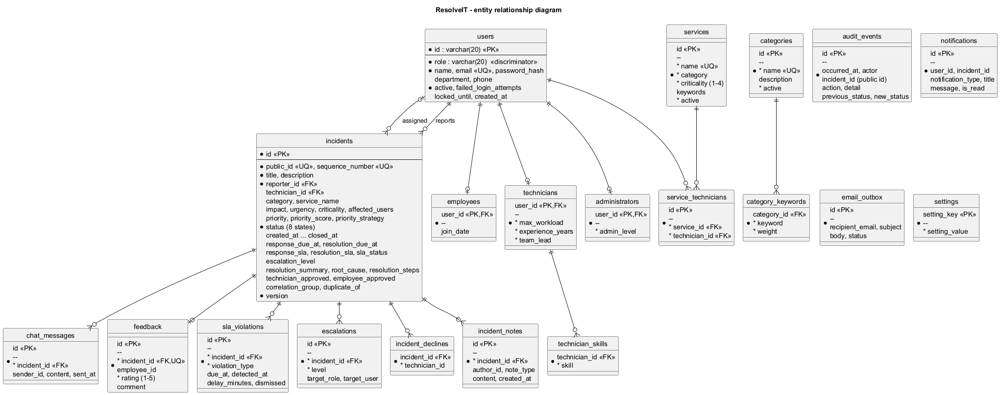

## 8.2 Schema

The schema is created by Flyway migration `V1__schema.sql`; `V2__seed_reference.sql` inserts the nine categories with more than 150 weighted keywords, nine IT services with their criticality, the SLA policy and the default strategy settings.

| Table | Purpose | Important columns and constraints |
|---|---|---|
| `users` | All accounts (root of the inheritance) | `id` PK (E101, T201, A001), `role` discriminator, `email` unique, `password_hash`, `active`, `failed_login_attempts`, `locked_until` |
| `employees` | Employee details | `user_id` PK/FK, `join_date` |
| `technicians` | Technician details | `user_id` PK/FK, `max_workload` (1–50), `experience_years`, `team_lead` |
| `technician_skills` | Skill categories of each technician | PK (`technician_id`, `skill`) |
| `administrators` | Administrator details | `user_id` PK/FK, `admin_level` |
| `categories` | Incident categories (data, not code) | `name` unique, `active` |
| `category_keywords` | Keywords for the classifier | `category_id` FK, `keyword`, `weight` |
| `services` | IT service catalog | `name` unique, `category`, `criticality` (1–4), `keywords`, `active` |
| `service_technicians` | Which technicians can work on which service | unique (`service_id`, `technician_id`) |
| `incidents` | The incident record | `public_id` unique, reporter and technician FKs, category, service, impact, urgency, criticality, affected users (all 1–4), priority, score, `status` (8 allowed values), all lifecycle time stamps, response and resolution deadlines, SLA states, escalation level, resolution fields, approvals, correlation group, `version` |
| `incident_declines` | Technicians who declined an incident | PK (`incident_id`, `technician_id`) |
| `incident_notes` | Investigation notes, information requests and replies | `incident_id` FK, `note_type`, `content`, `created_at` |
| `chat_messages` | Incident conversation | `incident_id` FK, `sender_id`, `content`, `sent_at` |
| `feedback` | Employee rating | `incident_id` unique FK, `rating` (1–5), `comment` |
| `sla_violations` | Recorded SLA breaches | unique (`incident_id`, `violation_type`), `due_at`, `detected_at`, `delay_minutes`, `dismissed` |
| `escalations` | Escalation steps | unique (`incident_id`, `level`), `target_role`, `target_user` |
| `audit_events` | Append-only history | `occurred_at`, `actor`, `incident_id`, `action`, `detail`, `previous_status`, `new_status` |
| `notifications` | In-app notifications | `user_id`, `incident_id`, `notification_type`, `title`, `message`, `is_read` |
| `email_outbox` | Simulated e-mails | `recipient_email`, `subject`, `status` |
| `settings` | Configuration key/value pairs | strategies, warning percent, SLA minutes per priority |

Indexes exist on the incident status, priority, reporter, technician, creation time, service and correlation group, which are the columns used by lists, search and reports.

## 8.3 Important relationships

- Each user row has exactly one matching row in `employees`, `technicians` or `administrators` (one-to-one, inheritance).
- An employee reports many incidents; a technician is assigned many incidents (one-to-many).
- An incident has many notes, chat messages, declines, SLA violations and escalations, and at most one feedback (composition).
- Technicians and services have a many-to-many relationship through `service_technicians`.
- A category has many keywords.
- Audit events and notifications refer to incidents by their public id, so they remain readable even when filtered across tables.

## 8.4 Sample data

Users (password `Password@123` for all demo accounts):

| ID | Name | Role | Details |
|---|---|---|---|
| A001 | Alex Morgan | Administrator | IT Operations |
| A004 | Rahul Verma | Administrator | IT manager (escalation level 4) |
| E101 | Jordan Lee | Employee | Finance |
| T201 | Priya Shah | Technician | Application, Software, Authentication; max 8; 6 years |
| T300 | Kavya Raman | Technician | Team lead (escalation level 2) |

IT services:

| Service | Category | Criticality |
|---|---|---|
| Payment | Application | 4 |
| Authentication | Authentication | 4 |
| Database | Database | 4 |
| Network | Network | 3 |
| Cloud Storage | Storage | 3 |
| General IT | Application | 1 |

Incidents (from the generated November 2026 data):

| ID | Title | Category | Service | I | U | C | A | Score | Priority | Status |
|---|---|---|---|---|---|---|---|---|---|---|
| INC1001 | Payment gateway returns error 502 | Application | Payment | 4 | 4 | 4 | 4 | 64 | P1 | Closed |
| INC1004 | Shared drive quota full for operations | Storage | Cloud Storage | 3 | 3 | 3 | 3 | 27 | P2 | Closed |
| INC1006 | Wifi very slow in sales area | Network | Network | 2 | 1 | 3 | 2 | 6 | P4 | Closed |
| INC1008 | Suspicious phishing email received | Security | Email | 1 | 1 | 3 | 2 | 6 | P4 | Closed |

Audit trail of INC1001 (times in IST):

| Time | User | Action | Previous → new status |
|---|---|---|---|
| 14:40 | E101 | Incident created | — |
| 14:40 | SYSTEM | Classified as APPLICATION | NEW → CLASSIFIED |
| 14:40 | SYSTEM | Priority calculated as P1 (score 64) | — |
| 14:40 | SYSTEM | Offered to technician T302 | CLASSIFIED → ASSIGNED |
| 14:48 | SYSTEM | Response SLA violated; escalated to technician | — |
| 14:48 | T302 | Offer accepted | ASSIGNED → ACKNOWLEDGED |
| 14:50 | T302 | Work started | ACKNOWLEDGED → IN_PROGRESS |
| 15:04 | T302 | Incident resolved | IN_PROGRESS → RESOLVED |
| later | T302, E101 | Closure approved by both | RESOLVED → VERIFIED → CLOSED |

# 9. Testing

## 9.1 Approach

We used two levels of automated testing with JUnit 5:

- **Unit tests** test single classes without starting the application: every lifecycle transition, the user hierarchy, both priority strategies, the three assignment strategies, the classifier, similarity, the observer mechanism, the e-mail adapter and JWT handling.
- **Integration tests** start the full Spring application on an in-memory H2 database in PostgreSQL mode, run the same Flyway migrations as production and call the real services and REST endpoints (through MockMvc). Every test runs inside a transaction that is rolled back, so tests are independent. A controllable clock lets us test SLA warnings, violations and escalation without waiting.

All tests run with one command: `mvnw test`. The latest run gave **172 tests, 0 failures, 0 errors, 0 skipped**.

| Test class | Tests | Focus |
|---|---|---|
| `IncidentStateTest` | 81 | All 12 legal and 52 illegal lifecycle moves, invariants |
| `UserHierarchyTest` | 7 | Inheritance, polymorphism, password hashing, lockout, UserFactory |
| `PriorityStrategyTest` | 16 | Both strategies, band boundaries, analysers, registry |
| `AssignmentStrategyTest` | 5 | Least load, round robin, skill and experience |
| `ClassifierAndSimilarityTest` | 5 | Keyword classifier, Jaccard similarity |
| `ObserverChannelEscalationTest` | 6 | Observer order and isolation, e-mail adapter, network failure, JWT |
| `IncidentWorkflowIntegrationTest` | 20 | Pipeline, lifecycle, duplicates, correlation, feedback, admin controls |
| `SlaEscalationIntegrationTest` | 6 | SLA warning and violation, idempotency, escalation chain |
| `ApiSecurityIntegrationTest` | 17 | Login, lockout, role and ownership checks, validation, errors, search |
| `AdminManagementIntegrationTest` | 9 | Users, services, categories, settings, reports, demo seeder |

## 9.2 Documented test cases

| ID | Test case | Type | Expected result | Result |
|---|---|---|---|---|
| T01 | Employee reports the payment outage | Normal | Incident created, classified Application, service Payment, P1 score 64, assigned, audit rows and notifications created | Pass |
| T02 | Priority of the payment outage | Business rule | 4 × 4 × 4 = 64 → P1 | Pass |
| T03 | Priority band boundaries (36/35, 18/17, 8/7) | Boundary | P1/P2, P2/P3, P3/P4 | Pass |
| T04 | Weighted strategy on worked examples | Business rule | Same ordering; 100 → P1, lowest → P4 | Pass |
| T05 | P1 SLA deadlines | Normal | Response +5 min, resolution +30 min | Pass |
| T06 | SLA warning at 80 % then violation | Business rule | One warning, then exactly one violation record | Pass |
| T07 | SLA monitor run twice | Business rule | No duplicate violations or notifications | Pass |
| T08 | NEW → CLOSED | Exception | Rejected (invalid state transition) | Pass |
| T09 | ASSIGNED → RESOLVED | Exception | Rejected | Pass |
| T10 | Least-load assignment | Business rule | Lowest load wins; tie goes to more experience | Pass |
| T11 | Round-robin assignment | Business rule | Technicians chosen in rotation | Pass |
| T12 | No eligible technician | Exception | Incident stays unassigned; administrators alerted | Pass |
| T13 | Technician declines an offer | Business rule | Offered to a different technician | Pass |
| T14 | Employee rejects closure | Business rule | Back to In progress; technician notified | Pass |
| T15 | Wrong password / wrong portal; 5 failures | Invalid input | Same generic 401; account locked (423) | Pass |
| T16 | Employee opens another employee's incident | Authorisation | 403 forbidden | Pass |
| T17 | Employee calls admin endpoints; technician acts on another's incident | Authorisation | 403 forbidden | Pass |
| T18 | Account creation ignores a role sent by the client | Authorisation | Account created as employee | Pass |
| T19 | Short title, empty description, HTML in text | Invalid input | 400 with field errors; HTML removed | Pass |
| T20 | Same employee reports the same problem twice | Exception | 409 duplicate with existing id; allowed with "submit anyway" | Pass |
| T21 | Three similar reports from different employees | Business rule | Linked as related; major-incident alert | Pass |
| T22 | P1 not acknowledged after the deadline | Business rule | Escalates technician → team lead → admin → IT manager, once per level | Pass |
| T23 | SLA policy missing | Exception | Defaults used; administrators notified; creation succeeds | Pass |
| T24 | Unknown service selected; no service keyword | Exception | 404 service not found; falls back to General IT | Pass |
| T25 | Audit records | Business rule | No update or delete method exists | Pass |
| T26 | Search by id, text, status, priority, category, service, technician, SLA, dates | Normal | Correct results, limited to the user's own scope | Pass |
| T27 | Observer throws an exception | Business rule | Other observers still run; action succeeds | Pass |
| T28 | Database unavailable | Exception | 503 with a generic message, no stack trace | Pass |
| T29 | Mail server unreachable | Exception | E-mail marked FAILED; network failure reported | Pass |
| T30 | Feedback rules | Business rule | Only after resolution, once, only by the reporter | Pass |
| T31 | Suggested resolutions | Normal | Similar closed incident suggested | Pass |
| T32 | Technician recommendation | Normal | Score equals the weighted formula of its parts | Pass |
| T33 | Switch priority strategy at run time | Business rule | Next incident uses the new strategy | Pass |
| T34 | New category with keywords | Business rule | Next matching incident gets the new category | Pass |
| T35 | Deactivate a technician | Business rule | Open work reassigned; sign-in blocked | Pass |

## 9.3 Manual testing

In addition we tested every page in the browser against PostgreSQL with the demo data: the employee flow (create ticket, track, chat, notifications, feedback), the technician flow (accept, start, note, request information, resolve, approve closure) and every administrator page (directory, services, configuration, edit incidents, analytics, SLA violations, audit log). No errors appeared in the browser console.

# 10. User Interface

The interface has three portals with a shared design: a fixed sidebar with the role's options, a top bar with the user's name, the notification bell and the profile menu, and a back-to-dashboard link on every page.

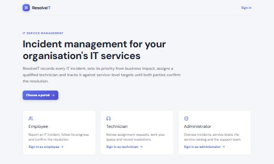{.shot}

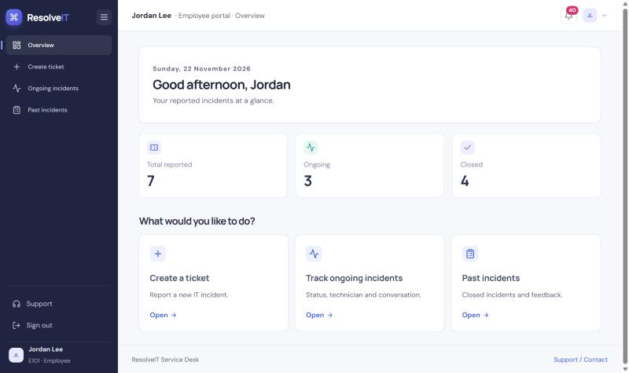{.shot}

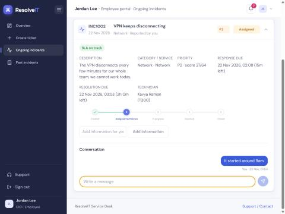{.shot}

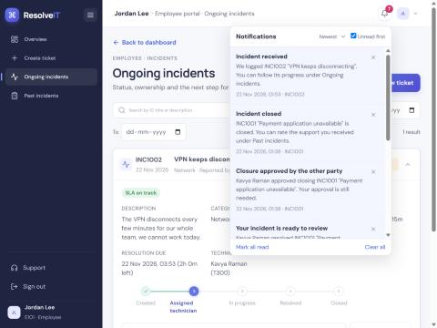{.shot}

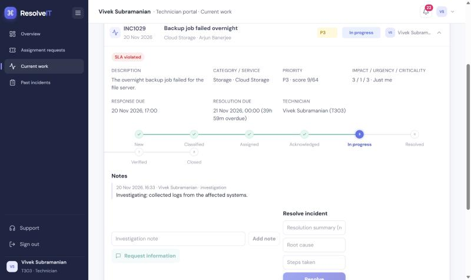{.shot}

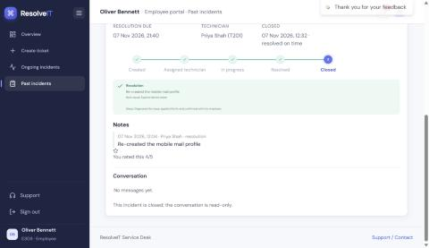{.shot}

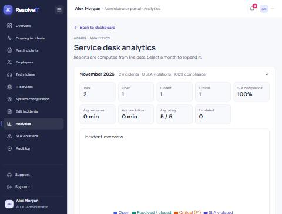{.shot}

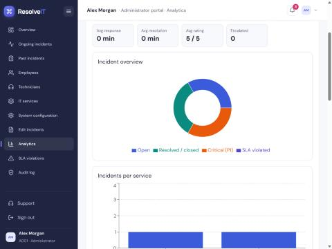{.shot}

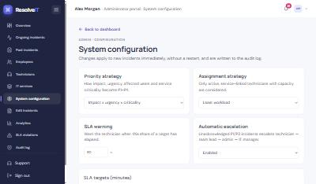{.shot}

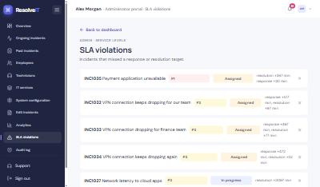{.shot}

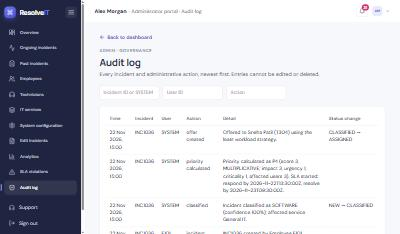{.shot}

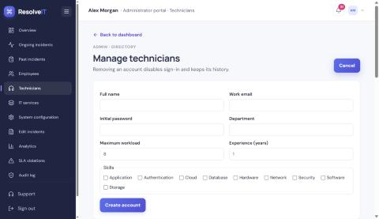{.shot}

# 11. Security Considerations

| Requirement | How ResolveIT meets it |
|---|---|
| Authentication | Sign-in with ID or e-mail, password and portal; a signed JSON Web Token (HS256) valid for four hours is sent with every request. Wrong password, unknown user and wrong portal give the same message. |
| Password protection | Passwords are stored only as BCrypt hashes (strength 10) and never returned or logged. New passwords need at least 8 characters with upper- and lower-case letters and a digit. Five failed attempts lock the account for 15 minutes. |
| Role-based authorisation | Every service method checks the user's role. |
| Protection against unauthorised operations | Ownership checks (`PortalUser.canView`) stop users from opening or changing incidents that are not theirs, even if they guess an id. |
| Input validation | Request objects are validated (lengths, ranges, required fields); HTML is removed from incident text; the database only receives parameterised queries through JPA. |
| Secure API access | Stateless sessions, CORS limited to the website's address, frame and content-type protection headers, no stack traces in responses. |
| Data integrity | Audit records cannot be changed or deleted; optimistic locking prevents two people overwriting the same incident; database constraints back the business rules. |

**Known limitations:** logged-out tokens are remembered only in memory; there are no refresh tokens, multi-factor authentication or rate limiting beyond the lockout; HTTPS has to be provided by the server it is deployed on.

# 12. Team and Contributions

| Member | ID | Responsibility |
|---|---|---|
| Shaurya Sharma | 2025A7PS0091H | Intelligent features and persistence: PostgreSQL schema and Flyway migrations, SLA monitoring and escalation, duplicate detection and correlation, suggested resolutions, integration of the backend with the database and the demo data |
| Rish Jain | 2025A7PS0107H | Backend and APIs: REST controllers, authentication and security, request validation, error handling, notifications and the API contract |
| Jinay Shah | 2025A7PS0136H | Backend OOP architecture: domain model, user hierarchy, State, Strategy, Observer, Factory, Adapter and Chain of Responsibility patterns, application services |
| Heet Mehta | 2025A7PS0043H | UI and UX: React frontend, role-based portals, dashboards, incident pages, chat and notification panel, analytics charts |

All members tested the system together and understand the overall design.

# 13. Conclusion

ResolveIT meets every item of the minimum viable product: three user roles; full incident management; automatic priority from impact, urgency, business criticality and affected users; three assignment strategies that can be switched at run time; SLA calculation, warnings and violation records; two notification channels; a complete audit trail; search with nine criteria; persistence in PostgreSQL; and several intelligent features (categorisation, automatic escalation, smart technician recommendation, SLA risk detection, duplicate and related-incident detection, and suggested resolutions).

The main lesson of the project was how much object-oriented design helps when requirements change: new priority rules, assignment strategies, notification channels, escalation levels and categories can all be added without touching the code that uses them. Possible future work includes push notifications through WebSockets, business-hour SLA calendars, real e-mail delivery and deployment to the cloud.
