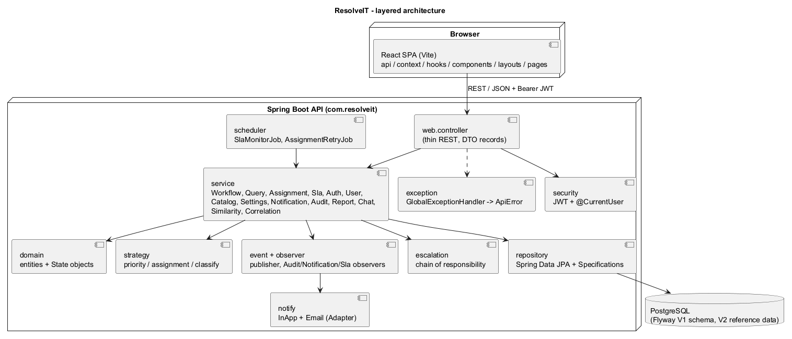

# 3. System Architecture

ResolveIT is a layered client-server system (diagram source: `docs/uml/architecture.puml`).

- **Presentation:** React 18 single-page app (Vite), organised as `api` (Axios client with JWT and error interceptor), `context` (authentication), `hooks`, `utils`, `components`, `layouts` and `pages/{auth,employee,shared,admin}`. TanStack Query polls notifications, chat and lists every 5 seconds.
- **API layer:** thin Spring MVC controllers in `web.controller` that accept validated DTO records and return DTO records. The authenticated user is injected with `@CurrentUser` (JWT verified by `security.JwtTokenService`). `exception.GlobalExceptionHandler` turns every failure into a uniform `ApiError`.
- **Application services (`service`):** `IncidentWorkflowService` (creation pipeline and lifecycle actions), `IncidentQueryService` (lists, detail, search), `AssignmentService`, `SlaService`, `escalation.EscalationService`, `NotificationService`, `AuditService`, `ReportService`, `ChatService`, `CatalogService`, `UserService`, `AuthService`, `SettingsService`, `SimilarityService`, `IncidentCorrelationService`.
- **Domain (`domain`):** JPA entities with behaviour. `Incident` is the aggregate root and delegates lifecycle rules to `IncidentState` objects.
- **Strategies (`strategy`):** priority, assignment and classification algorithms selected at runtime from the settings table.
- **Events (`event`, `observer`):** services publish `IncidentEvent`s; `SlaObserver`, `AuditObserver` and `NotificationObserver` react. Notifications are delivered through every `NotificationChannel` (in-app, email adapter).
- **Scheduler:** `SlaMonitorJob` (warnings, violations, escalations; every 30 s) and `AssignmentRetryJob` (unassigned incidents, P1 first; every 60 s).
- **Persistence:** Spring Data JPA repositories and JPA Specifications over **PostgreSQL**; the schema is versioned with Flyway and validated by Hibernate at start-up.

Request flow example (create incident): `IncidentController` → `IncidentWorkflowService.createIncident` → `IncidentFactory`, `KeywordCategoryClassifier`, `CatalogService.resolveService`, analysers, `PriorityStrategy`, `SlaService`, `IncidentCorrelationService`, `AssignmentService` → repositories → PostgreSQL; each step publishes an event that the observers turn into audit rows and notifications.

