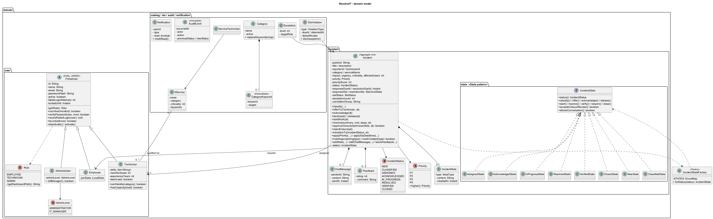
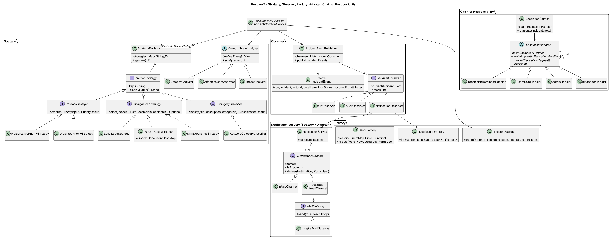
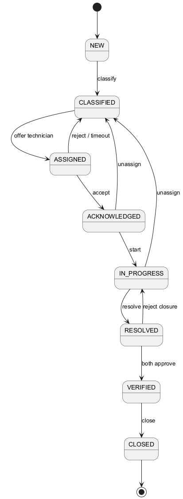

# 4. UML Diagrams

PlantUML sources are in `docs/uml/` (render with `java -jar plantuml.jar docs/uml/*.puml`; the `smetana` layout needs no Graphviz).

| Diagram | File | Content |
|---|---|---|
| Architecture (component) | `architecture.puml` | Layers and their dependencies |
| Domain class diagram | `classes.puml` | `PortalUser` hierarchy, `Incident` aggregate with composition of notes, chat and feedback, the eight State classes, catalog, SLA, audit and notification entities, associations and multiplicities |
| Pattern class diagram | `patterns.puml` | Strategy (priority, assignment, classifier, registry), Observer, notification Strategy + Adapter, Factory, Chain of Responsibility |
| State diagram | `lifecycle.puml` | NEW → CLASSIFIED → ASSIGNED → ACKNOWLEDGED → IN_PROGRESS → RESOLVED → VERIFIED → CLOSED with the reject / release / reopen paths |

