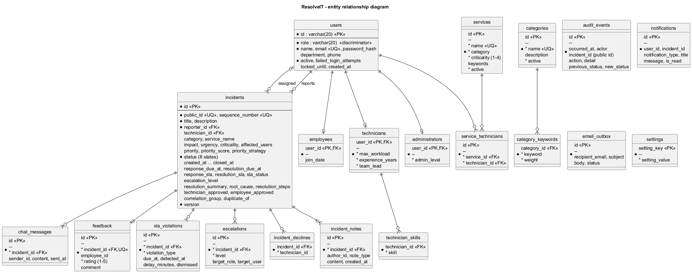

# 7. Database Design

PostgreSQL schema managed by Flyway (`backend/src/main/resources/db/migration`): `V1__schema.sql` creates every table, constraint and index; `V2__seed_reference.sql` inserts categories with 150+ classifier keywords, nine IT services with criticality and detection keywords, the SLA policy and the strategy settings. Hibernate runs with `ddl-auto=validate`. Demo people and November 2026 demo incidents are created by `seed/DemoDataSeeder` and `seed/DemoIncidentSeeder` through the real services.

| Table | Purpose and key columns |
|---|---|
| `users` | Shared account data (JOINED inheritance root): `id` PK (E101/T201/A001), `role` discriminator (CHECK), `email` UNIQUE, `password_hash` (BCrypt), `active`, `failed_login_attempts`, `locked_until` |
| `employees`, `technicians`, `administrators` | Subclass tables keyed by `user_id` → `users.id`; technicians: `max_workload` (CHECK 1–50), `experience_years`, `team_lead`; administrators: `admin_level` |
| `technician_skills` | Technician skill categories (PK technician_id + skill) |
| `categories`, `category_keywords` | Dynamic categories; weighted keywords for the classifier |
| `services`, `service_technicians` | IT service catalog (criticality CHECK 1–4) and qualified technicians (UNIQUE service + technician) |
| `incidents` | Aggregate root: `public_id` UNIQUE, `sequence_number` UNIQUE, reporter/technician FKs, category, service, impact/urgency/criticality/affected_users (CHECK 1–4), priority, score, strategy, `status` (CHECK of the eight states), all lifecycle timestamps, response/resolution deadlines, `response_sla`, `resolution_sla`, `sla_status`, `escalation_level`, resolution fields, approvals, `correlation_group`, `duplicate_of`, `version` (optimistic locking). Indexed on status, priority, reporter, technician, created_at, service, correlation group |
| `incident_declines` | Technicians who declined an incident (never offered again) |
| `incident_notes`, `chat_messages` | Composition children of an incident (ordered by time) |
| `feedback` | One rating (CHECK 1–5) per incident (UNIQUE incident_id) |
| `sla_violations` | One row per breached clock (UNIQUE incident + type), delay, dismissed flag |
| `escalations` | One row per escalation level (UNIQUE incident + level), target role and user |
| `audit_events` | Append-only history: time, actor, incident (or SYSTEM), action, detail, previous/new status |
| `notifications`, `email_outbox` | In-app notifications per user; simulated email deliveries |
| `settings` | Key/value configuration (strategies, warning percent, SLA minutes per priority) |

Relationships: users 1–1 subclass rows; incident N–1 reporter and N–1 technician; incident 1–N notes, chat messages, violations, escalations and declines; incident 1–0..1 feedback; service N–N technician through `service_technicians`; category 1–N keywords. The ER source is `docs/er/er.puml`.

Sample rows (demo data): `INC1001` "Payment gateway returns error 502", reporter E101, category Application, service Payment, impact 4, urgency 4, criticality 4 → P1 score 64, status CLOSED, response SLA VIOLATED; `settings('sla.P1.response.minutes','5')`; `services('Payment', criticality 4)`.
